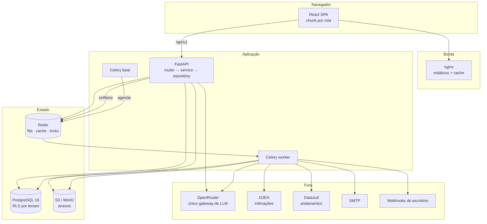
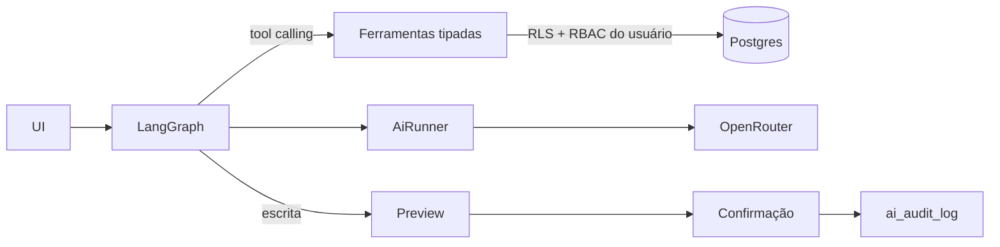

# Arquitetura do Rito

> Spec 100, §6. O mapa que faltava: onde cada coisa mora e **por que ali**. As decisões
> individuais e o histórico delas estão em `docs/DECISOES.md`; aqui está a forma.

## Visão geral



Duas coisas que o desenho já diz e valem ser ditas em voz alta: **toda chamada externa
sai do worker**, nunca do caminho de request (o usuário não espera o tribunal responder);
e **o Postgres é o único dono do estado** — Redis é descartável, S3 guarda bytes, e
nenhum dos dois é fonte de verdade.

## As quatro camadas do backend

```
router      só HTTP: recebe, valida schema, chama service, devolve. Um `select()` aqui é bug.
service     a regra. Não sabe o que é HTTP nem como o dado é guardado.
repository  só query. Não decide nada.
integration atrás de interface (LLMProvider, FileStorage, PublicationSource, WebhookSender).
```

A separação não é estética. Ela é o que permite que **os testes exercitem a regra
diretamente**, sem subir servidor nem tocar rede: um teste de service usa a
implementação de teste da interface, que é uma implementação real (LSP), não um mock que
finge. É por isso que 1.477 testes de backend rodam em quatro minutos.

## Isolamento entre escritórios

O Rito é multi-tenant desde a primeira tabela, e o isolamento **não é feito no
`WHERE`** — é feito pelo Postgres:

1. toda tabela de domínio tem `tenant_id NOT NULL`;
2. `ROW LEVEL SECURITY` ligado e forçado, com política sobre `current_setting('app.tenant_id')`;
3. a sessão seta `app.tenant_id` no início de cada request/task;
4. a aplicação usa a role `rito_app`, **sem `BYPASSRLS`**.

A consequência é a que interessa: um `SELECT` cru, escrito com pressa numa sexta-feira,
continua isolado. Um filtro esquecido não vira vazamento — vira zero linhas.

As três exceções são documentadas e fechadas: parceria entre escritórios (079),
biblioteca pública de modelos (068) e catálogos globais sem `tenant_id`. Detalhes e a
matriz de verificação em `docs/SEGURANCA-RLS.md`.

## Camada de IA



Quatro regras dão a forma:

- **OpenRouter é a única saída.** Trocar de modelo é configuração (`ai_feature_config`),
  nunca deploy.
- **RAG é proibido.** Sem vector store, sem embeddings. O contexto vem por **tool
  calling** — o agente consulta o banco por ferramentas tipadas que respeitam o RLS e o
  RBAC de quem está logado. Um agente nunca vê mais que a pessoa que o acionou.
- **Toda escrita passa por preview e confirmação humana**, e fica em `ai_audit_log`.
- **Nenhum teste chama modelo de verdade.** Fixtures gravadas, sempre.

Os sete vetores de ataque considerados estão em `docs/SEGURANCA-IA.md`.

## Frontend

```
components/ui/       shadcn — não editado à mão
components/domain/   DataTable, FilterBar, FormModal, EntityPicker, KanbanBoard, StatCard…
features/<ctx>/      páginas, hooks e client de API por contexto
lib/                 client HTTP com refresh automático, utilidades
```

O objetivo declarado desde a 007 é que **a 40ª tela custe pouco**. Uma listagem nova é
`useListPage` + `DataTable` + `FilterBar` e um schema de filtros — a paginação keyset, o
estado na URL, o export e os estados de vazio/erro vêm junto. Cada página é um chunk
próprio (`React.lazy`), e o editor de modelos e os gráficos ficam fora do bundle inicial.

## Observabilidade

Uma requisição carrega um `request_id` do primeiro middleware até o worker que ela
enfileirou — pelo contexto, no processo, e pelo `traceparent` W3C, na fila. Todo log é
JSON com `request_id`, `tenant_id`, `user_id`, rota e duração, e passa por redação de PII
antes de sair. Métricas em `/metrics`, trace por OTLP quando há coletor configurado.

`/health` é liveness e não toca em nada; `/health/ready` toca Postgres, Redis e storage,
com 2 s por sonda, e diz **qual** falhou.

## Ciclo de vida

```
spec → implementação → testes → make lint → make test (< 300 s) → commit → push
```

Um gate em cada ponta: o orçamento de tempo da suíte impede o projeto de ficar lento sem
ninguém notar, e o orçamento de **queries por endpoint** impede o N+1 de entrar sem
ninguém notar. Os dois falham o CI; nenhum é aviso.

## Onde ler mais

| Assunto | Documento |
|---|---|
| Como construir (stack, regras, SOLID) | `CLAUDE.md` |
| As 100 specs e o estado de cada uma | `ROADMAP.md` |
| Decisões e o porquê de cada uma | `docs/DECISOES.md` |
| Isolamento entre escritórios | `docs/SEGURANCA-RLS.md` |
| Superfície de ataque da IA | `docs/SEGURANCA-IA.md` |
| Linha de base de performance | `docs/PERFORMANCE.md` |
| Operar em produção | `docs/RUNBOOK.md` |
| Dívida conhecida e classificada | `docs/DIVIDA-TECNICA.md` |
